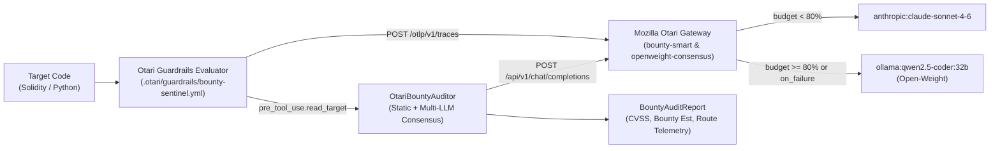

# Otari Bounty Sentinel — Budget-Aware Multi-LLM Security Auditor & Guardrail Engine

**Built with [Mozilla Otari (`mozilla-ai/otari`)](https://github.com/mozilla-ai/otari) for the Mozilla Otari Hackathon: Devs Wilding Online! (`https://dorahacks.io/hackathon/mozilla-devs-wilding/detail`)**

`Otari Bounty Sentinel` is an autonomous security audit and bug-bounty triage engine that showcases **Mozilla Otari's** three core pillars in a real developer workflow:
1. **Budget-Aware & Open-Weight Adaptive Routing (`config.otari.example.yml`):** Routes primary vulnerability triage through the `bounty-smart` policy (`anthropic:claude-sonnet-4-6`), automatically switches to local open-weight models (`ollama:qwen2.5-coder:32b`) when virtual key spend reaches `>=80%` (`when: { budget_used_pct: { gte: 80 } }`) or during upstream provider outages (`on_failure`), and cross-checks every finding with `openweight-consensus` (`ollama:qwen2.5-coder:32b` / `ollama:deepseek-r1:14b`).
2. **Repository-Committed Agent Guardrails (`.otari/guardrails/bounty-sentinel.yml`):** Enforces `path`, `command`, and `command_if_changed` gates at `pre_tool_use.read_target`, `pre_tool_use.edit_target`, `pre_tool_use.command`, and `stop.session`, and exports OpenTelemetry (`otari.gate`) check spans to `/otlp/v1/traces`.
3. **Unified Otari Gateway SDK Normalizer & DX Feedback ([`OTARI_FEEDBACK.md`](OTARI_FEEDBACK.md)):** Reconciles the `OTARI_BASE_URL` vs `OTARI_URL` path split across `/api/v1`, `/api`, and `/otlp/v1/traces`, and resolves nested open-weight model families (`ollama:qwen2.5-coder:32b` -> `qwen`, `openrouter:deepseek/deepseek-r1` -> `deepseek`).

---

## Architecture



---

## Repository Structure

```text
mozilla-otari-hackathon/
├── .otari/
│   └── guardrails/
│       └── bounty-sentinel.yml          # Schema v1.0 Mozilla Otari Agent Guardrails policy
├── config.otari.example.yml             # Mozilla Otari gateway config (routing policies & budgets)
├── pyproject.toml                       # Python package & pytest configuration
├── README.md                            # Architecture & quickstart guide
├── OTARI_FEEDBACK.md                    # 7 reproducible DX/SDK findings & upstream patch proposals
├── SUBMISSION_GUIDE.md                  # DoraHacks BUIDL submission copy
├── logs/
│   └── sample_execution.log             # Full JSON execution artifact from CLI showcase
├── src/
│   └── otari_bounty_sentinel/
│       ├── __init__.py
│       ├── schemas.py                   # Pydantic v2 telemetry, audit, & guardrail models
│       ├── gateway_client.py            # Unified Otari client + URL & model family normalizers
│       ├── mock_otari_gateway.py        # Self-contained Mozilla Otari `/api/v1` & `/otlp` simulator
│       ├── guardrails_engine.py         # `.otari/guardrails/` policy evaluator & OTLP exporter
│       ├── auditor.py                   # Multi-LLM Consensus security auditor
│       ├── dashboard.py                 # FastAPI Web Dashboard & REST API
│       └── cli.py                       # Rich CLI demo & JSON exporter
└── tests/
    ├── test_bounty_sentinel.py          # End-to-end tests (routing, failover, budget, FastAPI, CLI)
    └── test_otari_feedback_repro.py     # Automated reproduction tests for OTARI-01..OTARI-07
```

---

## Quickstart (100% Reproducible Offline or Against Live Otari)

```bash
# 1. Create virtual environment and install dependencies
uv venv .venv
uv pip install --python .venv/bin/python fastapi uvicorn httpx pydantic pyyaml click pytest rich openai
uv pip install --python .venv/bin/python -e . --no-deps

# 2. Run the full test suite (10/10 passing tests)
.venv/bin/pytest -v

# 3. Run the Rich CLI showcase and export execution logs
.venv/bin/python -m otari_bounty_sentinel.cli --mode demo --export-log logs/sample_execution.log
```
